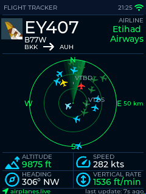

# ESP32 Flight Tracker



A real-time flight tracking display for ESP32 boards with a 2.8" 240x320 ILI9341 TFT. The project fetches live ADS-B aircraft data from adsb.lol, plots nearby flights on a radar-style map, and optionally enriches them with airline and route metadata plus airline logos.

## Supported hardware

Two board variants are supported:

| Variant | Board | PlatformIO env | Display config |
| :--- | :--- | :--- | :--- |
| **CBD** (Cheap Black Display) — default | ESP32-S3 ES3C28P / Freenove FNK0104A-B | `esp32-s3-es3c28p` | `include/User_Setup_S3.h` |
| **CYD** (Cheap Yellow Display) | ESP32-2432S028R | `esp32-2432S028R` | `include/User_Setup.h` |

## What this project does

- Fetches live aircraft positions from adsb.lol `/v2/point`
- Sorts aircraft by distance from your configured GPS center
- Enriches the closest aircraft with route and airline data from adsb.lol `/api/0/routeset`
- Displays aircraft on a radar map with speed, altitude, heading and flight metadata
- Supports optional airline logo fetches via LogoStream
- Stores configuration in NVS/Preferences and airline names in LittleFS
- Runs as a dual-core FreeRTOS application with split UI and network responsibilities

## Architecture

The app is structured around a few key tasks and components:

| Task / Component | Core | Purpose |
| :--- | :--- | :--- |
| `UI_Task` | 0 | LVGL timer handling, screen refreshes, flight rendering |
| `HTTP_Task` | 1 | Fetches aircraft data, enriches closest flight, pushes updates to queue |
| `Fetch_Logo_Task` | 1 | Downloads and decodes airline PNG logos in background |
| `webConfig` | shared | WiFi AP/STA configuration, captive portal, NVS persistence |
| `flight_tracker_ui` | UI thread | LVGL scene and radar drawing logic |

### Data flow

1. `HTTP_Task` calls `get_flights()` and fetches aircraft from adsb.lol `/v2/point`.
2. Aircraft are sorted by distance from the configured location.
3. The closest aircraft is enriched via adsb.lol `/api/0/routeset`, which may include airline and route details.
4. Updates are pushed to the single-slot queue using overwrite semantics.
5. `UI_Task` consumes the latest aircraft snapshot and redraws the radar and info panels.
6. Logo requests follow a separate queue, decode pipeline, and UI response path.

## Build and flash

This project uses **PlatformIO**.

```bash
pio run                        # build the default env (CBD / esp32-s3-es3c28p)
pio run -e esp32-2432S028R     # build the CYD variant
pio run -t upload              # compile + flash the active environment
pio run -t uploadfs            # upload LittleFS data files like airlines.txt
pio device monitor            # serial monitor at 115200 baud
```

### Notes

- The default build is `esp32-s3-es3c28p`.
- The CYD target uses `huge_app.csv` as its partition layout.
- The CBD target uses `default_16MB.csv`.
- The default platform settings include `monitor_filters = esp32_exception_decoder`.
- TFT driver setup is board-specific and is included from `include/User_Setup.h` or `include/User_Setup_S3.h`.

## Configuration

On first boot, the device starts in setup mode:

1. Connect to the WiFi network named `FlightTracker-Setup`
2. Open `http://192.168.4.1` in a browser
3. Configure:
   - WiFi SSID and password
   - Latitude and longitude
   - Tracking radius in kilometers
   - Optional adsb.lol API key for higher rate limits
   - Logo support toggle for airline image fetching
4. Save the settings; the device reboots and reconnects to your WiFi

After the device is online, open `http://esp32-flighttracker.local/settings` to change the same values later. If your network does not support mDNS, use the device's IP address instead.

## Filesystem and data files

The project stores runtime data in LittleFS.

- `data/airlines.txt` contains ICAO-to-airline-name mappings in the format `ICAO|FullName`
- This file is uploaded to the device using:

```bash
pio run -t uploadfs
```

## Dependencies

- TFT_eSPI `^2.5.43`
- ArduinoJson `^7.4.3`
- LVGL `^9.1.0`
- LodePNG (vendored under `lib/lodepng`)

## Project notes and caveats

- LVGL is C-based; the UI code in `src/ui/flight_tracker_ui.c` uses `extern "C"` linkage.
- The radar canvas and other large allocations are sensitive to heap limits; memory pressure is a real concern on ESP32.
- Inter-task communication uses FreeRTOS queues with single-slot overwrite semantics.
- The app uses a hardcoded NTP timezone offset of `25200` (UTC+7) in `main.cpp`.
- The project has no automated test suite at this time; the `test/` directory is currently empty.
- The old FlightRadar24 implementation is retained in `legacy/` for reference but is not part of the active build.

## Data sources

- **adsb.lol**: live aircraft positions and route/airline enrichment data
- **LogoStream**: optional airline logo fetching and caching

Distance and bearing calculations use the Haversine approach.

---

This project is for educational and personal use. Please respect the terms of service of all data providers and upstream APIs used by the device.
